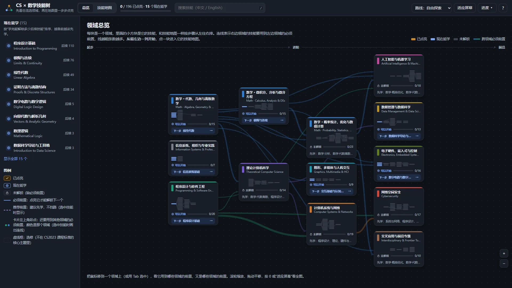
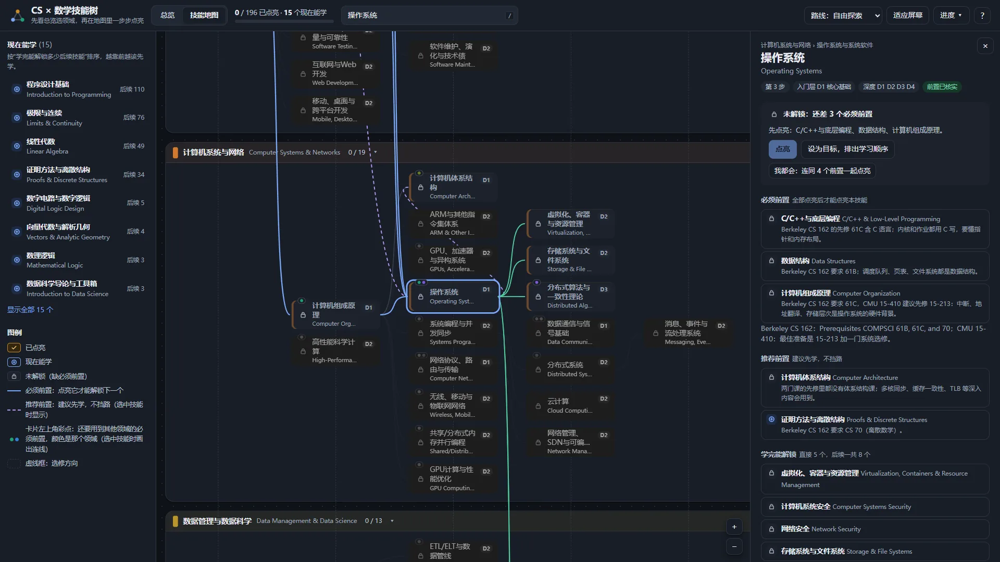
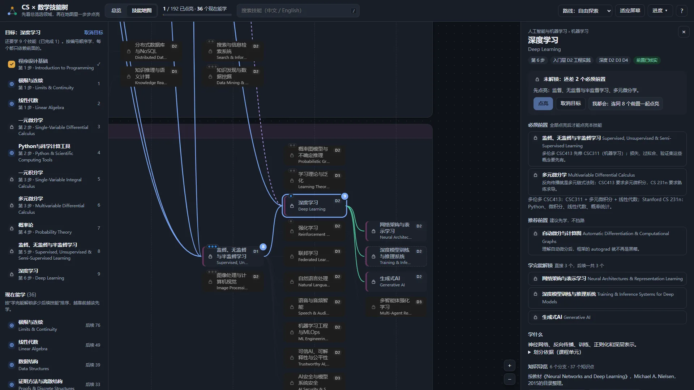
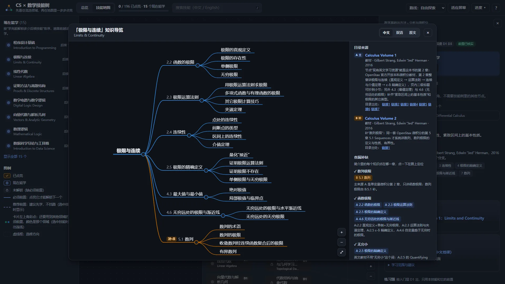

<p align="center">
  <a href="https://www.bilibili.com/video/BV1FTx46CEN8/"></a>
</p>

<h1 align="center">CS × 数学技能树</h1>

<p align="center">
  把计算机专业要学的东西，做成一棵<b>能一步步点亮的技能树</b>。<br>
  每条“必须先学”的连线，都来自真实大学课程的官方先修要求。
</p>

<p align="center">
  <a href="https://zeroa234.github.io/cs-math-skill-tree/"><b>在线打开</b></a> ·
  <a href="https://github.com/zeroa234/cs-math-skill-tree/releases/latest"><b>下载离线包</b></a> ·
  <a href="https://www.bilibili.com/video/BV1FTx46CEN8/"><b>看宣传片（B 站）</b></a> ·
  <a href="#怎么读这张图">怎么读这张图</a> ·
  <a href="#数据从哪来">数据从哪来</a>
</p>

> An interactive skill tree for a computer-science degree and the math behind it: 196 skills in 13 areas, gated by prerequisites quoted from real university course pages. Every skill comes with free learning resources (English and Chinese), one worked exercise, and a knowledge map built from an authoritative textbook's or course's table of contents. A static page that works offline. The interface is in Chinese; every skill also has its English name.

## 预览

<table>
  <tr>
    <td width="50%"><br><b>领域总览</b>：13 个领域按依赖排成列，线越粗、跨领域的必须前置越多</td>
    <td width="50%"><br><b>技能地图</b>：选中“操作系统”，高亮它的整条前置链和直接解锁的技能</td>
  </tr>
  <tr>
    <td><br><b>设为目标</b>：把“深度学习”设为目标，左栏排出按顺序编号的学习清单</td>
    <td><br><b>知识导览图</b>：按教材目录画出“极限与连续”的知识点，右栏是来源和查漏补缺</td>
  </tr>
</table>

## 有什么

| | |
|---|---|
| 技能 | **196** 个，分 13 个领域（数学拆成三条泳道），按最长的必须前置链排成 **7** 步 |
| 前置关系 | **270** 条必须前置（没点亮就不能点亮下一个），**389** 条推荐前置（只提示，不挡路） |
| 前置依据 | 187 个技能已用课程证据核实，共引用 **362** 条官方先修原文（300 多门课），每条附原始链接；其余 9 个标“前置待核实” |
| 学习资源 | 每个技能都有英文和中文资源，标明免费 / 注册 / 付费、学习范围，以及中文资源是否只覆盖部分内容 |
| 练习题 | 每个技能 1 道，答案折叠，答案已验算 |
| 知识导览图 | 每个技能 1 张：**1,879** 个分支、**8,593** 个知识点；**10,509** 条章节标题都和来源目录页逐条核对过 |

其他：

- 纯静态页面，不需要构建、不需要联网（只有打开学习资源链接时才联网）。
- 进度存在浏览器里，可以导出 / 导入 JSON。
- 每个视图都有自己的地址，可以收藏或分享：`#overview` 是总览，`#map/<领域>` 是领域地图，`#skill/<id>` 是技能详情，`#skill/<id>/guide` 是知识导览图。
- 支持纯键盘操作，手机上总览变成可滑动的列表。按 WCAG 2.2 AA 做过无障碍审计（[结论](docs/hci-ux-review.md)）。

## 打开

- **在线**：<https://zeroa234.github.io/cs-math-skill-tree/>
- **离线**：从 [Releases](https://github.com/zeroa234/cs-math-skill-tree/releases/latest) 下载 zip，解压后双击 `index.html`
- **从源码**：克隆仓库后双击 `src/web/index.html`

## 怎么读这张图

- **领域总览（首页）**：每块是一个领域，块里的小方块是它的技能，和技能地图一样按步骤从左到右排列。连线表示右边领域的技能用到了左边领域的必须前置，线越粗，条数越多。第 1 列可以直接开始。每块上写着进度、状态、“下一步”（这个领域现在最值得学的技能）或“先学：…”。点一块进入它的技能地图。
- **技能地图**：每条横向泳道是一个领域。横轴“第 N 步”的意思是：前面最长有 N−1 层必须前置。第 1 步的技能没有必须前置，是起点。
- **卡片状态**：已点亮（暖色 + ✓）、现在能学（蓝框 + ⊕）、未解锁（灰 + 锁）。颜色之外都有图标，色弱也能分辨。
- **选中一个技能**：高亮它的整条必须前置链（实线）、推荐前置（虚线）和它直接解锁的技能（绿线）。用到其他领域前置的卡片，左上角有那个领域颜色的彩点。
- **左栏**：“现在能学”按“学完能解锁多少后续技能”排序。选一条路线或“设为目标”后，左栏给出按顺序编号的学习清单。
- **详情面板**：必须 / 推荐前置及理由、学什么、知识导览、去哪学（中英文分开，附访问条件和学习范围）、练习题，以及前置依据（课程官方先修原文）。
- **知识导览图**：双击技能卡（或选中后按 G）。中心是技能，分支是来源的章（或讲），叶子是节。标“补·B”的橙色分支来自补充来源，补的是主来源没讲到的知识点。标题可以切换中文 / 双语 / 原文。右栏“查漏补缺”列出技能简介里的每个知识点落在哪一章，点一下就在图上定位。

## 数据从哪来

起点是一张 ChatGPT 生成的“计算机科学与数学知识星图”（原文件只读保存在 `data/source/chatgpt-outputs/`）：259 个节点、317 条关系（228 条前置、89 条相关），但前置不分必须和推荐，也没有给出依据。这里沿用它的技能划分和简介（201 个技能），再对照 ACM/IEEE-CS/AAAI 的课程标准 CS2023 检查划分：拆得过细的合并、几个不相干领域拼成的收窄或删除、缺的游戏开发补上，现为 196 个（改了什么、为什么改见 [技能划分检查](reports/skill-partition-review-2026-11-01.md)）。前置关系按真实课程的先修要求重新判定，学习资源、练习题和导览图都是重新找证据做的。检索和整理借助了 AI 代理，结论都附可以打开核对的原始链接。

**必须 / 推荐前置怎么判定**

- **必须前置**：至少一门真实大学课程把它列为先修（或在同一门课里先讲它），并且不会它就学不懂本技能入门层的内容。
- **推荐前置**：课程写成“建议 / 有帮助”、只有部分课程要求、只是数学成熟度门槛，或者只在深入层才用到。
- 找不到可用课程先修说明的 9 个技能按内容需要起草，页面上标“前置待核实”：F.2.4、P.5.4、C.4.4、D.1.5、S.2.4、S.5.2、H.4.4、I.2.3、X.2.4。

**知识导览图怎么来**

- 每个技能 1 个主来源：优先用“去哪学”里那份材料本身（它有成体系的目录时），否则用标准教材（作者主页、出版社或开放教材官网上的目录），或一流大学课程官方的逐讲课表。
- 只用作者或出版社官方公开的整书 PDF，课程网站、网盘、镜像站上的商业教材 PDF 不用。
- 标题照原文抄，再配中文译名。`scripts/check_outlines.py` 把每条标题和实际抓到的来源页面文字逐条比对：10,498 条逐字命中，11 条因 PDF 抽字差异（如 σ 被抽成 s）判为近似，没有缺失。
- 已知缺口：A.2.3.2、C.3.3、S.2.1 的来源只有讲次一层；技能简介里有 13 个知识点在所有来源里都没有专门章节，导览图右栏标“—”并写明原因。

逐个技能的来源和适用性见 [来源审核报告](reports/source-review-2026-11-01.md)，中文资源的增补依据见 [中文资源报告](reports/chinese-resources-expansion-2026-11-01.md)。

## 数据文件

想拿数据做别的东西，直接用构建好的两个 JSON：

| 文件 | 内容 |
|---|---|
| `output/skilltree.json` | 全部技能：名称（中 / 英）、领域、步骤、必须 / 推荐前置及理由、课程先修原文、学习资源、练习题 |
| `output/outlines.json` | 全部知识导览图：来源、目录（章 → 节）、查漏补缺 |

它们由 `data/` 下的源数据合并而来，各目录的作用和数据流见 [维护说明](docs/maintenance.md#数据流)。

## 从源码构建

```bash
npm install
node scripts/build.mjs              # 重新生成 src/web/data.js、outlines.js 和 output/*.json；前置有环、ID 写错、卡片重叠、导览图来源对不上都会直接报错
node tests/screenshot.mjs           # 用系统自带的 Edge 无头截图检查页面（playwright-core，不下载浏览器）
node tests/a11y.mjs                 # axe-core 按 WCAG 2.2 AA 审计 15 个界面状态
python -X utf8 scripts/package_web.py   # 打包离线 zip
```

不要直接改生成的 `src/web/data.js`。全部脚本、学习资源的维护规则和检索流程见 [维护说明](docs/maintenance.md)。

## 宣传片

在哔哩哔哩观看：[大肥鱼把计算机专业内容做成了技能树](https://www.bilibili.com/video/BV1FTx46CEN8/)（约 2 分钟）。用 Remotion 和 Blender 做成，画面里的数字和树的形状都从数据算出来，做法见 [docs/promo-video.md](docs/promo-video.md)。片中的数字（201 个技能、278 条必须前置）是重新划分技能之前的版本，以上面“有什么”里的数字为准。

## 用到的开源组件

- [elkjs](https://github.com/kieler/elkjs) 0.12.1（EPL-2.0，只在构建时运行）：技能地图和领域总览的分层布局
- [@panzoom/panzoom](https://github.com/timmywil/panzoom) 4.6.2（MIT）：平移缩放
- [markmap-view](https://github.com/markmap/markmap) 0.18.12（MIT）+ [d3](https://d3js.org) 7.9.0（ISC）：知识导览图，第一次打开导览图时才加载
- [axe-core](https://github.com/dequelabs/axe-core)（MPL-2.0，开发依赖）：无障碍审计
- [pypdf](https://github.com/py-pdf/pypdf)（BSD）：抽取 PDF 目录文字

页面用到的三个库放在 `src/web/vendor/`，各自的许可证和库文件放在同一个目录。

## 许可

- 代码和本仓库整理的数据：[MIT](LICENSE)。
- `src/web/vendor/` 里的第三方库沿用各自的许可证。
- 课程先修原文、教材和课程目录的标题引自各自的来源，只用于引用和核对，版权归原作者；每条都附原始链接。
